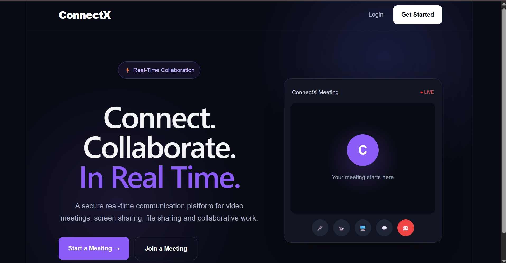
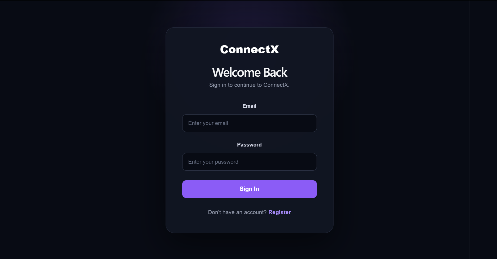
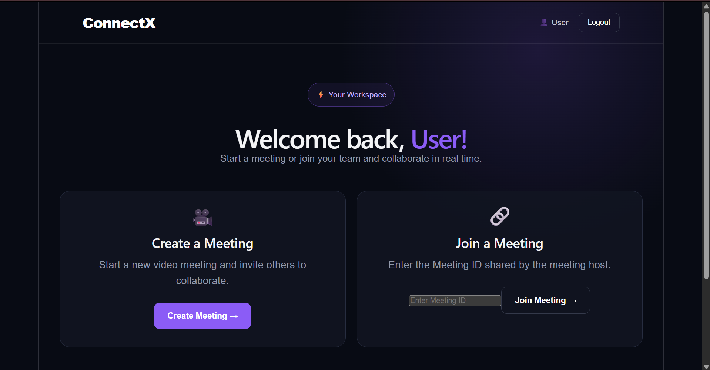
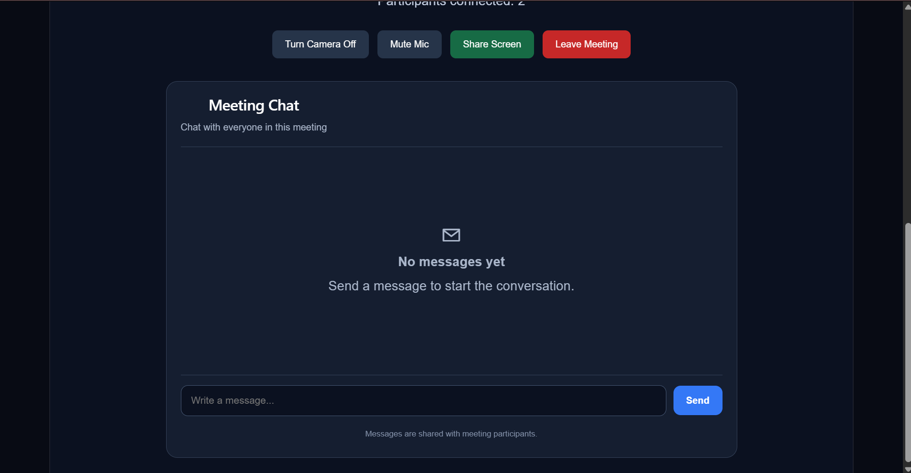
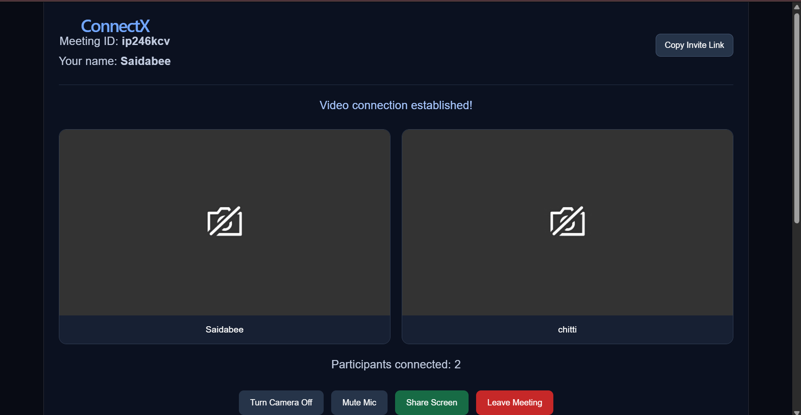

# ConnectX – Real-Time Communication App

**Connect. Collaborate. In Real Time.**

ConnectX is a real-time communication web application that enables users to connect through video meetings, audio communication, and instant messaging. It is built using modern web technologies to support online collaboration.

## Features

- 🎥 **Video Calling** – Real-time video communication.
- 🎙️ **Audio Communication** – Talk with other participants.
- 👥 **Multi-Participant Meetings** – Connect multiple users in a meeting room.
- 💬 **Live Chat** – Exchange messages during meetings.
- 🖥️ **Screen Sharing** – Share your screen with participants.
- 📷 **Camera Controls** – Manage camera access during meetings.
- 🔇 **Microphone Controls** – Turn your microphone on or off.
- 🔗 **Meeting Rooms** – Create or join meetings.
- 🗄️ **Database Integration** – MongoDB integration for application data.

## Tech Stack

| Technology | Purpose |
|---|---|
| React | Frontend user interface |
| JavaScript | Application logic |
| Node.js | Backend runtime |
| Express.js | Backend framework |
| Socket.IO | Real-time events and communication |
| WebRTC | Peer-to-peer audio and video |
| MongoDB | Database |

## Project Structure

The project includes a React frontend and a Node.js backend.

```text
Real-Time-Communication-App/
├── client/              # React frontend (if applicable)
├── server/              # Backend (if applicable)
├── package.json
├── README.md
└── .gitignore
```

*Note: Update the folder names above to match your actual repository structure.*

## Getting Started

### Prerequisites

- Node.js and npm
- MongoDB
- Git

### Installation

**1. Clone the repository**

```bash
git clone YOUR_REPOSITORY_URL
cd Real-Time-Communication-App
```

**2. Install dependencies**

Run `npm install` in the frontend and backend directories that contain their respective `package.json` files.

**3. Configure environment variables**

Create the required local `.env` files based on your application configuration. Add your MongoDB connection string and other required settings locally.

**Never upload `.env` files, passwords, database credentials, or API keys to GitHub.**

**4. Run the application**

Start the backend and frontend using the scripts defined in their respective `package.json` files.

Open the local frontend URL displayed in your terminal.
## Screenshots

### Home Page


### Login Page


### Dashboard


### Chat Box


### Meeting Room


## What I Learned

- Building a full-stack web application
- Implementing real-time communication using Socket.IO
- Working with WebRTC for audio and video
- Connecting a Node.js backend to MongoDB
- Managing React components and application state

## Future Improvements

- Improve unread-message notifications
- Enhance meeting reliability and error handling
- Deploy the application for public access
- Improve the user interface and accessibility

## Author

**Saidabee Dudekula**

Computer Science & Engineering Student | Aspiring Software Engineer

---

*ConnectX is a learning and portfolio project focused on real-time communication and full-stack web development.*
